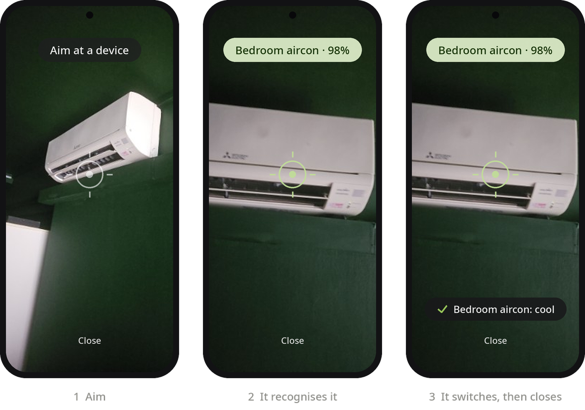
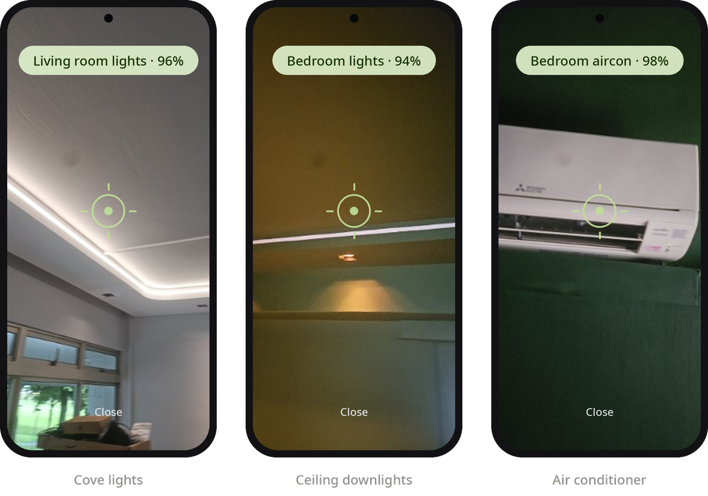
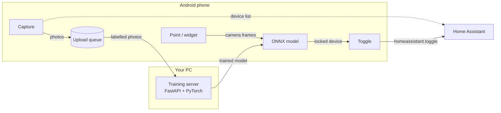
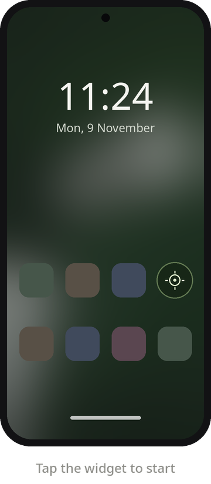

# PointRemote

Point your phone at a light, fan or air conditioner, and it switches. No buttons to find, no app menus: the phone recognises what you're looking at and toggles it through [Home Assistant](https://www.home-assistant.io/).

The recogniser is a small image classifier that **you train yourself**, on photos of your own home, on your own PC. Nothing leaves your network.

<p align="center"></p>

## How it works

1. **Capture.** In the app, pick a device from Home Assistant and hold the shutter while you walk around it. It takes about three photos a second. You also photograph things that *aren't* devices (walls, furniture, the floor) under **Unknown**, so the model learns when not to react.
2. **Train.** The photos upload to a small server on your PC, which fine-tunes [MobileNetV3](https://pytorch.org/vision/stable/models/mobilenetv3.html) on your GPU (a few minutes; CPU works too, just slower) and exports it to ONNX.
3. **Point.** The phone downloads the model and runs it on every camera frame with ONNX Runtime. A device only "locks" after several frames in a row agree with high confidence, and Unknown never locks, so sweeping past things doesn't trigger anything.
4. **Switch.** The locked device is toggled through Home Assistant's REST API.

<p align="center"></p>

Because the model learns your rooms rather than generic "a lamp", it can tell apart two identical lights in different rooms, as long as the rooms look different.



## The widget



A one-cell home-screen widget (and a Quick Settings tile) opens **quick-point**: a bare camera screen that switches the first device it recognises, then closes itself. Point, done, back to your home screen.

The widget is smoked glass tinted with your wallpaper's colours (Android 12+), and the launcher recolours it when you change wallpaper.

If you'd rather confirm each switch, turn off **Switch without tapping** in Settings and quick-point waits for a tap.

<br clear="right">

## What you need

- **An Android phone**, Android 10 or newer.
- **Home Assistant**, reachable from the phone, and a [long-lived access token](https://www.home-assistant.io/docs/authentication/#your-account-profile).
- **A PC** for training, with Python 3.12 and [uv](https://docs.astral.sh/uv/). An NVIDIA GPU makes training take minutes instead of tens of minutes. The server's `pyproject.toml` pulls CUDA 12.8 builds of PyTorch; change the `pytorch-cu128` index if you need a different CUDA or CPU-only build.
- **To build the app:** JDK 21 and the Android SDK (Gradle downloads the rest).

## Setup

### 1. Training server (PC)

```bash
cd server
uv sync
echo "POINTREMOTE_API_KEY=$(python3 -c 'import secrets; print(secrets.token_urlsafe(24))')" > .env
./run.sh
```

It listens on port 8765. Check `http://<pc-ip>:8765/ui` loads from your phone's browser; if not, your PC's firewall is probably blocking the port. There's also a small web page there for browsing photos and training history. More detail is in [server/README.md](server/README.md).

### 2. App

```bash
cd android
./gradlew assembleDebug
```

Install `android/app/build/outputs/apk/debug/app-debug.apk` on your phone, then in **Settings** enter:

- your Home Assistant URL and token,
- the server URL (`http://<pc-ip>:8765`) and the API key from `server/.env`.

Both have a **Test** button.

### 3. Teach it your home

1. **Capture:** add a device and take around 100 photos of it from different angles, distances and lighting (day, night, on, off).
2. Take at least as many **Unknown** photos: everything in the room that isn't a device you want to control.
3. **Train:** tap Train. The screen shows overall accuracy, accuracy per device, and which devices it confuses with each other. The phone picks up the new model by itself.
4. Add devices a few at a time and retrain after each batch. If two get mixed up, take more photos of both from the angles where they look alike.

Supported device types: lights, switches, fans, covers, media players, input booleans and climate (air conditioners). The device picker hides settings switches, hidden and offline entities by default, and has a search box.

## Privacy and security

- **Photos and training stay on your PC.** The phone only talks to your Home Assistant and your training server.
- **Everything runs over plain HTTP on your home network.** It's meant for a trusted LAN; don't expose port 8765 to the internet. The server requires its API key for everything, and the app only toggles entities in the device types listed above.
- **Settings are encrypted on the phone** (Android Keystore), and app backup is off, so your tokens aren't copied to cloud backups.

## Project layout

| Path | What's there |
| --- | --- |
| `server/` | FastAPI training server: photo store, training (PyTorch, MobileNetV3), ONNX export with an accuracy check, versioned model registry, small web UI |
| `android/` | Kotlin + Jetpack Compose app: CameraX capture, ONNX Runtime inference, lock tracking, Home Assistant client, widget (Glance) and Quick Settings tile |
| `docs/` | Design spec, implementation plans and the README images |

## Tests

```bash
cd server && uv run pytest
```

```bash
cd android && ./gradlew testDebugUnitTest
```

The server suite includes a real training run on the GPU when one is available.

## License

[GPL-3.0](LICENSE). You can use, change and share it; if you share a modified version, it has to stay open source under the same license.
